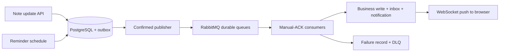

# NotesWeb · Backend

Backend for **NotesWeb**, a personal notes and to-do app with deadline reminders pushed to the browser in real time.

**Live app:** [nhannotes.id.vn](https://nhannotes.id.vn) · **API docs (Swagger):** [server.nhannotes.id.vn](https://server.nhannotes.id.vn) · **Frontend repo:** [NNTN32/NotesWeb_FE](https://github.com/NNTN32/NotesWeb_FE)

## What problem it solves

People keep notes and to-dos in one place and want to be reminded on time, without the app slowing down or losing work when traffic spikes. The backend does three things for that:

- **Store notes, media and to-do lists safely per user**, so each user only ever sees and changes their own data.
- **Never lose a reminder or an edit.** Slow work (login checks, note updates, reminders) runs in the background through queues with retries, and a failed message is kept for inspection instead of being dropped.
- **Push changes instantly.** Reminders and updates reach the open browser over WebSocket, so nobody has to refresh.

## Features

| Area | What you can do |
|---|---|
| Account | Register, log in, log out, refresh the session. Access token (JWT) + HttpOnly refresh cookie that rotates on every use; reuse of an old refresh token is detected. Login and register are rate-limited. |
| Notes | Create, list, read, update and delete your own notes. Edits are processed in order, so a newer edit never overtakes an older one. |
| Media | Upload images/files to a note (stored on Cloudinary, up to 100 MB) and delete them. |
| To-do lists | Create lists, update items and status, delete lists. |
| Reminders | Set a deadline (`HH:mm`, in your time zone) and how early to be reminded (`PT1M`, `PT30M`, …). The reminder is delivered on time, even across restarts. |
| Real time | STOMP over WebSocket (`/ws`) pushes reminders and updates to the browser. |

## Tech stack

| Layer | Technology |
|---|---|
| Language / framework | Java 21, Spring Boot **3.5.16**, Spring Security, Spring Data JPA |
| Database | PostgreSQL 15 (UUID v7 ordered keys, transactional outbox/inbox) |
| Cache / streams | Redis 7 (sessions, rate limits, Redis Streams for login and auth events) |
| Messaging | RabbitMQ 3.13 (publisher confirms, manual ACK, retry, dead-letter queue, STOMP relay) |
| Real time | WebSocket + STOMP |
| Media storage | Cloudinary |
| API docs | springdoc OpenAPI 3 / Swagger UI |
| CI/CD | GitHub Actions → private GHCR image (pinned by digest) → CapRover deploy, with health/smoke gates and automatic rollback |
| Hosting | AWS Lightsail (Malaysia), CapRover on Docker Swarm, Cloudflare proxy + origin TLS |

## How it works

The code is a **modular monolith**: one deployable app split into `auth`, `notes` (with media), `todos` (with reminders), and shared `platform` code ([package map](notesWeb/docs/feature-modules.md)).

<p align="center">
  
</p>

A note update or reminder is saved to PostgreSQL together with an outbox record in the same transaction. Only after that does a worker publish it to RabbitMQ, so a crash can never lose it:



The inbox makes every consumer idempotent: a message delivered twice is applied once. More detail: [reliable messaging](notesWeb/docs/reliable-messaging-pr2.md), [note updates on RabbitMQ](notesWeb/docs/rabbit-note-updates-pr3.md), [rate limits](notesWeb/docs/api-rate-limits.md).

## Try it

### Option 1: use the live API (no setup)

1. Open [server.nhannotes.id.vn](https://server.nhannotes.id.vn) (Swagger UI).
2. `POST /api/auth/register` with an email, username and password.
3. `POST /api/auth/login`. The response contains a `sessionId` (login is processed in the background).
4. `GET /api/auth/login/result/{sessionId}` until it returns `accessToken`.
5. Click **Authorize**, paste the token, then try `/notes`, `/todo` and `/reminder` (send header `X-TimeZone`, e.g. `Asia/Ho_Chi_Minh`).

### Option 2: run everything locally with Docker

Requirements: Docker with Compose.

```bash
git clone https://github.com/NNTN32/NotesWebApp.git
cd NotesWebApp/notesWeb
cp .env.example .env
```

Edit `.env` before the first start:

- `DB_PASSWORD`: any local password.
- `JWT_SECRET`: at least 32 characters.
- `RABBIT_USERNAME` / `RABBIT_PASSWORD`: a user other than `guest` (RabbitMQ only allows `guest` from inside its own container).
- `DOCKERHUB_USERNAME=local`: only names the locally built image.
- Add `APP_MESSAGING_INITIALIZE_SCHEMA=true`: creates the messaging tables in a fresh database.
- `CLOUDINARY_*`: optional, only needed for media upload.

```bash
docker compose up -d --build --wait
```

Open [localhost:8081](http://localhost:8081) for Swagger and follow steps 2–5 above. RabbitMQ UI: [localhost:15672](http://localhost:15672). Stop with `docker compose down` (add `-v` to wipe local data).

### Option 3: run the app from your IDE

Start only PostgreSQL, Redis and RabbitMQ in Docker, then run `NotesWebApplication` with Java 21 on port 8082. See [local run guide](notesWeb/docs/local-run.md) for ports and IDE settings.

### Tests

```bash
node --test scripts/ci/*.test.mjs                 # CI/CD scripts
cd notesWeb && ./mvnw -B test '-Dtest=!*IntegrationTest,!NotesWebApplicationTests'   # unit tests
```

Integration tests need disposable PostgreSQL/Redis/RabbitMQ; CI provides them ([CI.yml](.github/workflows/CI.yml)).

## Deployment

Every merge to `main` is released automatically, so production always runs the `main` head:

PR checks → build multi-arch image → push to private GHCR by digest → deploy to CapRover app `server` → check served revision, readiness and public smoke test for 120 s → promote `latest`. If a check fails, the previous `latest` is redeployed and the run stays red. Each run posts its result to Discord.

Production runs on one Lightsail VM behind Cloudflare. PostgreSQL, Redis and RabbitMQ have no public ports. Encrypted backups go to S3 daily and are restore-tested; CloudWatch alarms report to Discord. One VM means no high availability.

Runbooks: [CI/CD](notesWeb/docs/ci-cd.md) · [secrets and credentials](notesWeb/docs/secrets-and-credentials.md) · [contributor rules](CLAUDE.md)
