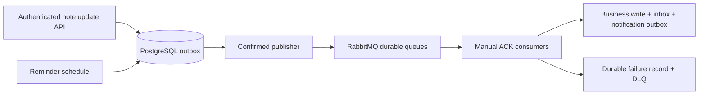

# Notes Web Application

**A high-performance, real-time, event-driven Notes application** built with modern Java/Spring Boot stack, focusing on scalability, security, and reliable messaging.

**Production**: Lightsail Malaysia · Dokploy / Docker Swarm · Cloudflare DNS/proxy + origin TLS
📖 **[API Documentation](https://server.nhannotes.id.vn)** (Swagger UI)
📂 **[GitHub Repository](https://github.com/NNTN32/NotesWebApp)**

## ✨ Key Features
- Modular Monolith architecture with clean separation of concerns (Auth, Notes, Media services)
- Real-time collaborative notes & instant reminder push via WebSocket (STOMP)
- Event-driven asynchronous processing (login, note updates) using Redis Streams + RabbitMQ and a PostgreSQL outbox
- Reliable scheduled & delayed notifications with PostgreSQL due-time scheduling, RabbitMQ, retries and a durable DLQ
- Secure JWT authentication with HttpOnly Refresh Token rotation + suspicious reuse detection
- High-performance PostgreSQL with UUID v7 (ordered) primary keys + Idempotency guarantees

## 🛠️ Tech Stack

**Backend**
- Java 21, Spring Boot 3.5.16, Spring Security, RESTful API
- Message Broker / Event-Driven: RabbitMQ, Redis Streams, PostgreSQL outbox/inbox, Asynchronous Processing
- Database & Caching: PostgreSQL, UUID v7, Redis
- Security: JWT, OAuth2, RBAC (Role-Based Access Control)
- Real-time: WebSocket, STOMP

**DevOps & Deployment**
- Docker, Docker Swarm (orchestration), Dokploy (self-hosted PaaS)
- Cloudflare DNS/proxy with origin TLS (Full strict)
- CI/CD via GitHub Actions → immutable Docker Hub digest → Dokploy API; health/smoke gates and guarded rollback

**Concepts**
Modular Monolith, Event-Driven Architecture (EDA), Idempotency, Scalability

## 🏗️ Architecture Highlights

[Backend package ownership](notesWeb/docs/feature-modules.md): `auth`, `notes` (including media), `todos` (including reminders), generic `platform`, `shared` and startup wiring. Spring Boot remains pinned to **3.5.16**; RabbitMQ/outbox contracts are unchanged.

- **Modular Monolith** → Clean separation of concerns, easy to maintain and scale

  

- **Event-Driven System** → Decoupled services, high throughput under load

**Note updates and reminders:**

Note edits keep their event ID across retries. A per-note outbox order check prevents a newer edit from overtaking an unfinished edit. See [PR 3 cutover and regression checks](notesWeb/docs/rabbit-note-updates-pr3.md).

## 🔥 Challenges & How I Solved Them

| # | Problem | Solution |
|---|---------|----------|
| 1 | API response time degraded under high load due to synchronous processing of login & note updates | Architected **event-driven system** with **Redis Streams + RabbitMQ/outbox**; HTTP 202 follows a durable command write |
| 2 | Need reliable scheduled reminders + delayed message delivery without losing messages | Built robust notification system using **PostgreSQL scheduling + RabbitMQ, transactional retries and DLQ** |
| 3 | Secure authentication & session management in distributed environment, prevent token reuse attacks | Implemented **JWT with HttpOnly Refresh Token rotation**, integrated with **Redis** for session management + suspicious reuse detection |
| 4 | Users required real-time updates for collaborative notes and reminders | Integrated **full-duplex WebSocket (STOMP)** for instant push notifications |
| 5 | Risk of duplicate data processing + inefficient primary key generation in distributed system | Used **PostgreSQL + UUID v7 (ordered)** + implemented **Idempotency logic** |
| 6 | Operate a small production stack with a recovery path | **Lightsail + Dokploy + Cloudflare**, monitored releases and encrypted off-VM backups; one VM is not highly available |

## 📖 API Documentation & Exploration

This project uses **OpenAPI 3.0 (Swagger)** to manage and document the entire API system. You can interact directly with the endpoints at:

🔗 **[https://server.nhannotes.id.vn](https://server.nhannotes.id.vn)**

**Testing Tips:**
- **Authentication:** Some endpoints require JWT. You can use the `auth-controller` endpoint to log in/register (email, username & password), obtain a Token, and then click the **"Authorize"** button at the top of the Swagger page to paste the token.
- **Time Zone:** You must set the time zone (e.g., Asia/Ho_Chi_Minh) before the deadline. Additionally, the due date must be entered in HH:mm format, and the reminder time must be PT1M, PT... depending on how long you want the reminder to be.

## Deployment and recovery

[Release runbook](notesWeb/docs/ci-cd.md) · [Contributor/process rules](CLAUDE.md)

PR tests → merged/current main → build immutable digest → verify Lightsail identity → Dokploy API deploy → exact running image/revision + readiness/public smoke → 120-second observation → promote latest. No production deployment from PRs, feature branches or direct main pushes; a merge commit titled with `[skip deploy]` (CI/docs-only changes) skips publish and deploy. The deploy job uses the main-only **ProductBE** environment.

Readiness checks PostgreSQL/Redis/RabbitMQ; Docker uses application liveness. A failed gate restores the previous pinned image only if no concurrent/ambiguous deployment intervenes. CI stays red and records sanitized evidence in `backend-deployment`. Rollback keeps current data, env and networks; it is not a database restore.

Production runs on `notesweb-my-01`, Malaysia (`ap-southeast-5`), with PostgreSQL, Redis and RabbitMQ private in Docker networks. OrbStack is retired and preserved for recovery, never an automatic deploy destination. Encrypted backups live outside the VM. The 24-hour soak was waived; this single VM has no HA guarantee.
